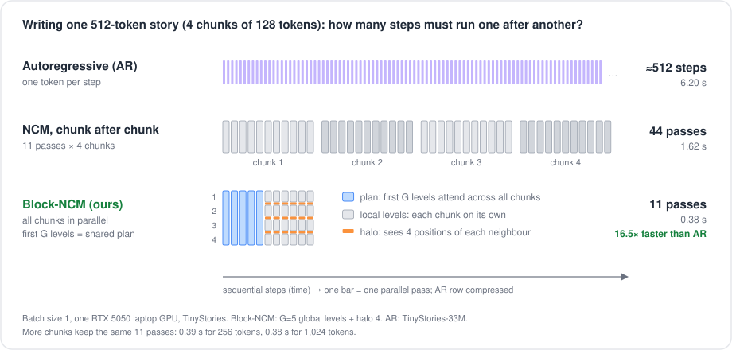
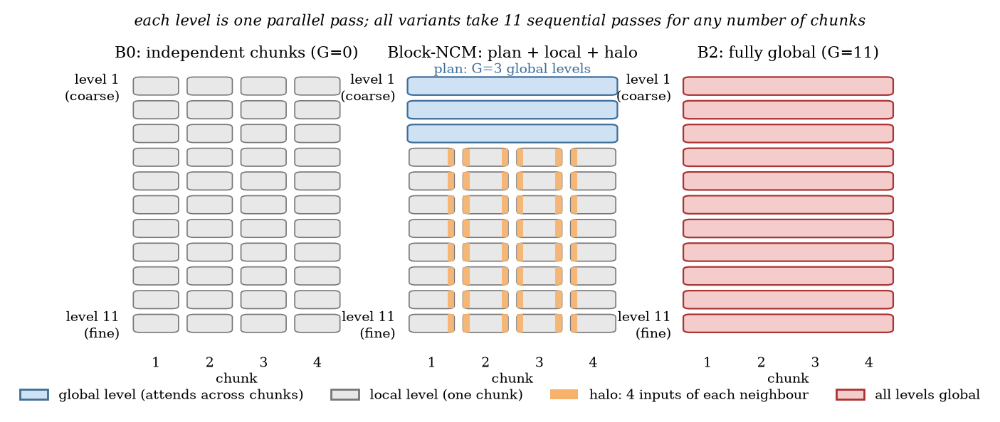
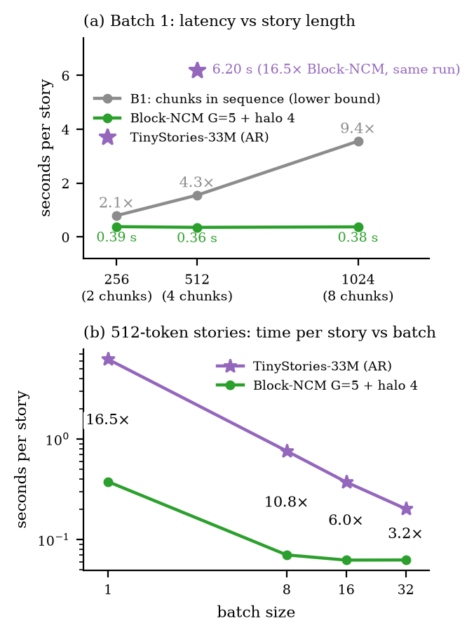
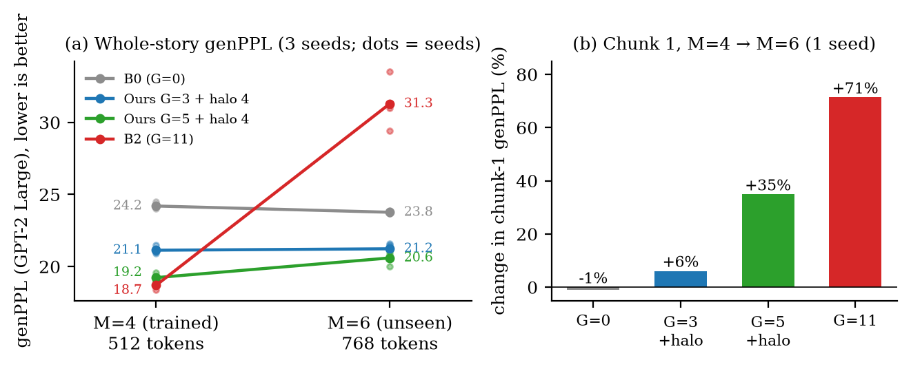

<h1 align="center"> Block-NCM</h1>

<p align="center"><strong>Long Stories in a Constant Number of Parallel Passes</strong></p>

<p align="center">
  <a href="paper/blockncm.pdf"></a>
  <a href="https://github.com/HazyResearch/ncm"></a>
  
  
  <a href="LICENSE"></a>
</p>

[Next-Concept Models](https://github.com/HazyResearch/ncm) (NCM) write a 128-token text coarse to fine in **11
parallel passes**, one per level of a residual code hierarchy. **Block-NCM** extends them to long outputs without
adding passes: the first **G** coarse levels form a **story plan shared by all chunks**, the remaining levels are
**local to each chunk**, and a small **halo** lets each chunk see a few positions of its neighbours. A story of any
number of chunks still takes **11 passes**.

<p align="center">
  
</p>

## Highlights

### Plan, local levels and halo

Every variant below takes 11 sequential passes. B0 never lets chunks talk to each other; B2 lets every level attend
across all chunks; Block-NCM shares only the coarse plan and adds a 4-position halo between neighbouring chunks.

<p align="center"></p>

### Flat latency as stories get longer

At batch size 1, Block-NCM writes a 512-token story **16.5× faster** than a smaller autoregressive model on the same
GPU (3.2× at batch 32). Its latency stays at about **0.37 s from 256 to 1,024 tokens**, while generating chunks one
after another becomes up to 9.4× slower.

<p align="center"></p>

### Robust beyond the trained length

Sharing every level (B2) gives the best text at the trained length but collapses at 1.5× that length
(18.7 → 31.3 genPPL over three seeds). Block-NCM with a small plan holds (G=3: 21.1 → 21.2).

<p align="center"></p>

## Results

512-token TinyStories stories (4 chunks), temperature 1.0, mean over three training seeds. genPPL is scored by
GPT-2 Large (lower is better); seams compare genPPL across chunk boundaries with inside chunks (1.0 = no seam).

| Model | Passes | genPPL (4 chunks) | Seams | genPPL (6 chunks, unseen) | Time / story |
|---|---|---|---|---|---|
| Real stories | – | 6.1 | 1.01 | – | – |
| AR, TinyStories-33M | ≈512 | **9.9** | 1.04 | – | 6.20 s |
| NCM, chunk after chunk (B1) | 44 | – | – | – | 1.62 s |
| B0, independent chunks (G=0) | 11 | 24.2 | 1.49 | 23.8 | ≈0.38 s |
| **Block-NCM, G=3 + halo 4** | 11 | 21.1 | 1.20 | **21.2** | ≈0.38 s |
| **Block-NCM, G=5 + halo 4** | 11 | 19.2 | 1.14 | 20.6 | **0.38 s** |
| B2, fully global (G=11) | 11 | **18.7** | 1.12 | 31.3 | ≈0.38 s |

**Honest limits.** Block-NCM's text is still about 2× worse than the AR model's by genPPL, a gap mostly inherited
from the base NCM (16.4 on single chunks vs 9.7 for AR). The speed advantage is largest at small batch and moderate
length. All results are on TinyStories with an 89M-parameter generator. Details, failed ideas and every number are in
the [paper](paper/blockncm.pdf) and the [results log](RESULTS.md).

<details>
<summary><b>Uncurated sample</b> (Block-NCM G=5 + halo 4, 512 tokens, chunk seams marked ‖)</summary>

> Lily and Ben are playing with paper in the living room. They like to make pictures of animals house and cars.
> Lily has a big box of paper. She likes to wear stickers and stickers. Ben likes to stickers and toys.<br>
> "Look at my jar, Ben. This is big. It is pink. It has five six. It is pink. It is said on paper. You are a good
> job. I am proud," Lily says.<br>
> "That is nice, Ben. is not it?" she asks<br>
> "Yes, it is not very heavy," Lily says.<br>
> "No, it does not ‖ dirty," Ben says. …

The most common mistakes are doubled or dropped words ("stickers and stickers") and mixed-up speakers, not the
chunk seams; see [RESULTS.md](RESULTS.md) ("Which mistakes are most common").
</details>

## How it works

1. Each 128-token chunk is encoded independently by the frozen released NCM tokenizer (11 levels of codes).
2. Levels 1…G are generated **globally**: at each level, all chunks attend to each other. This is the plan.
3. Levels G+1…11 are generated **locally**, with chunks folded into the batch; each chunk attends to itself, to the
   plan, and (with a halo) to a few positions of each neighbour.
4. `G = 0` gives independent chunks (B0) and `G = 11` a fully global model (B2). Every variant takes **11
   sequential passes**, versus 11·M for generating M chunks one after another.

Block-NCM is fine-tuned from the released TinyStories NCM (1,500 steps × 8 stories, conditioning corruption, a
KV-cached plan), so it trains on free Kaggle T4s or an 8 GB laptop GPU.

## Setup (WSL2 Ubuntu or Linux, CUDA GPU)

```bash
python3 -m venv ~/venvs/ncm && source ~/venvs/ncm/bin/activate
pip install torch --index-url https://download.pytorch.org/whl/cu128   # RTX 50-series needs CUDA 12.8+
git clone https://github.com/HazyResearch/ncm ~/ncm && pip install -r ~/ncm/requirements.txt
# fix HazyResearch/ncm issue #11 (idx_to_zhats aliasing)
sed -i '651s/z_hat.add_(z_q_level)/z_hat = z_hat + z_q_level/' ~/ncm/models/quant.py
git clone https://github.com/Rishab-Gupta24/block-ncm && cd block-ncm
```

Download `tinystories/*` from [`hazyresearch/ncm-checkpoints`](https://huggingface.co/hazyresearch/ncm-checkpoints)
into `~/ncm/checkpoints/tinystories`, and `tinystories/train_bpe_8192.{bin,_offsets.npy}` from
[`hazyresearch/ncm-datasets`](https://huggingface.co/datasets/hazyresearch/ncm-datasets) into `~/ncm/data/tinystories`.

```bash
export NCM_ROOT=~/ncm
# check that the chunked model with one chunk reproduces the released NCM exactly
python experiments/test_equivalence.py --ckpt ~/ncm/checkpoints/tinystories --data ~/ncm/data/tinystories
# encode stories into 4 chunks of NCM codes
python experiments/prepare_chunks.py --M 4 --data ~/ncm/data/tinystories --ckpt ~/ncm/checkpoints/tinystories --out ~/ncm/data/chunked
# train the main model (G=5 global levels, halo 4)
python experiments/train.py --M 4 --G 5 --halo 4 --name oursc_M4_G5_halo4 \
  --steps 1500 --bs 8 --lr 3e-5 --corrupt-mean 0.5 --grad-ckpt --fast
# sample 2 × 256 stories and score genPPL, entropy, seams and latency (use --M 6 for the unseen length)
python experiments/sample_eval.py --run ~/ncm/runs/oursc_M4_G5_halo4 --M 4 --G 5 --fast
```

[`kaggle/run_seed.sh`](kaggle/run_seed.sh) runs the main models on Kaggle's two free T4 GPUs.

## Repository layout

| Path | What it is |
|---|---|
| `blockncm/model.py` | `ChunkedNCM`: one attention-mask rule for training and generation around the released generator |
| `blockncm/fast.py` | KV-cached plan and halo attention (exact, faster) |
| `blockncm/load.py` | Loads the released tokenizer and generator exactly as the NCM repo's evaluation does |
| `experiments/` | Data preparation, training, sampling and scoring, timing, and every analysis in the paper |
| `kaggle/` | Scripts for the multi-seed runs on Kaggle |
| `paper/` | LaTeX source, PDF and figure scripts for the paper |
| `docs/` | Design notes and the plan for the follow-up paper |
| `RESULTS.md` | Full results log, including negative results |

## What's next

The follow-up work targets quality while staying much faster than AR: training on mixed story lengths, a
plan-first variant with explicit character and length slots, a correction step, and test-time search.
See [docs/paper2_plan.md](docs/paper2_plan.md).

## Citation

```bibtex
@misc{gupta2026blockncm,
      title={Block-NCM: Long Stories in a Constant Number of Parallel Passes},
      author={Rishab Gupta},
      year={2026},
      howpublished={\url{https://github.com/Rishab-Gupta24/block-ncm}},
}
```

Block-NCM builds on Next-Concept Modeling (Kumbong et al., 2026, [arXiv:2610.14162](https://arxiv.org/abs/2610.14162);
code under the MIT license). Please cite it as well. Released under the [MIT license](LICENSE).
